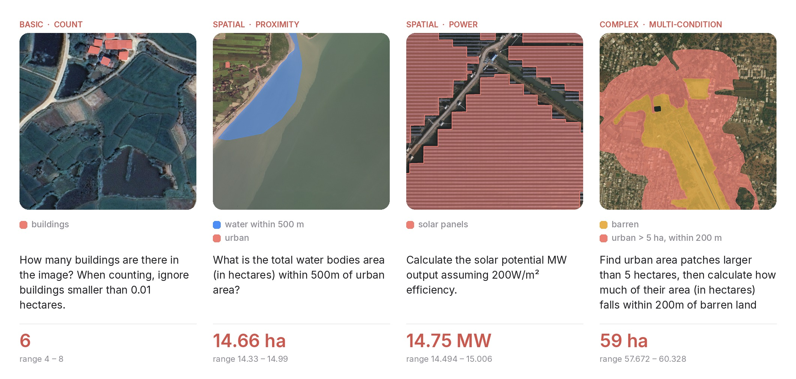

<p align="center">
  
</p>

<h1 align="center">SQuID: Satellite Quantitative Intelligence Dataset</h1>

<p align="center">
  <a href="https://arxiv.org/abs/2601.13401"></a>
  <a href="https://huggingface.co/datasets/PeterAM4/SQuID"></a>
  <a href="https://huggingface.co/PeterAM4/SQuID-DINOv3-Mask2Former"></a>
</p>

SQuID asks vision-language models to measure satellite images: count objects, compute areas and reason about distances. Its 2,000 questions cover 639 images from four sources at 0.3 to 1.0 m GSD. Most answers are computed from reference masks, and the 50 NAIP questions use human-consensus answers. SQuID-Train adds 75,687 questions on 1,443 other images. As a baseline, QASR (Quantitative Agentic Spatial Reasoning) has an LLM write a program that segments the image and measures the masks.



## Quick start

```bash
pip install -r requirements.txt
python data/download.py    # images, masks and JSONs into data/
```

```python
from datasets import load_dataset

bench = load_dataset("PeterAM4/SQuID", "benchmark", split="test")

ex = bench[0]
ex["question"]   # 'What percentage of the image is agricultural land within 50m of water bodies? (GSD: 0.3m)'
ex["answer"]     # '29.32', correct within [ex["acceptable_range_lower"], ex["acceptable_range_upper"]]
```

Evaluate GPT-5 end to end, or QASR with GPT-5 on the reference masks:

```bash
python benchmark/benchmark_gpt.py --api-key $OPENAI_API_KEY --model gpt-5
OPENAI_API_KEY=... ./run_oracle_gt.sh
```

Commands for the systems of the paper are in [REPRODUCE.md](REPRODUCE.md).

## Repository

```
data/          download.py fills benchmark/ and train/ from Hugging Face
generation/    builds the dataset and its tolerances from the masks and human annotations
evaluation/    QASR: the code-writing agent and its segmentation backends
benchmark/     the evaluation runners and the scoring rule
training/      LoRA fine-tuning on SQuID-Train
```

## Rebuild the dataset

The generators are deterministic. This rebuilds both splits from the downloaded masks and checks that they match the release byte for byte:

```bash
bash generation/run.sh
```

## Train

```bash
torchrun --nproc_per_node=4 training/train_lora.py --output_dir runs/squid_lora
python benchmark/benchmark_lora.py --lora_path runs/squid_lora --output_dir results/lora
```

## Citation

```bibtex
@misc{massih2026squidbenchmarkquantitativespatial,
  title         = {SQuID: A Benchmark for Quantitative Spatial Reasoning on Satellite Imagery},
  author        = {Peter A. Massih and Eric Cosatto and Martin Renqiang Min},
  year          = {2026},
  eprint        = {2601.13401},
  archivePrefix = {arXiv},
  primaryClass  = {cs.CV},
  url           = {https://arxiv.org/abs/2601.13401}
}
```

Code is MIT. The dataset is CC BY-NC 4.0, and its images and masks keep the terms of their sources.
